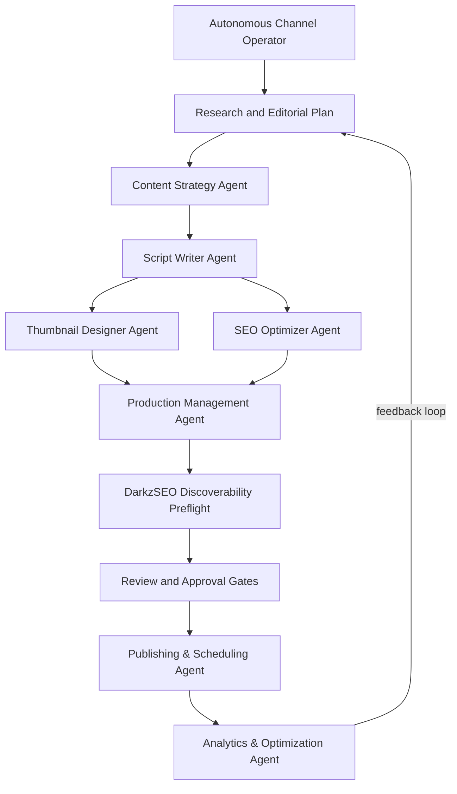

# YouTube Automation Agent

**The open-source AI agent that runs a YouTube channel end to end, with you approving every video before it goes out.**

It researches topics, writes scripts, generates narration and visuals, assembles real MP4s, writes titles, descriptions and tags, schedules approved videos, and learns from analytics and from what your audience says. It runs on your own machine with your own API keys.

[](https://github.com/darkzOGx/youtube-automation-agent/actions/workflows/ci.yml)
[](LICENSE)
[](package.json)

**Latest release:** v2.11.0 (October 13, 2026). See the [changelog](CHANGELOG.md) for release notes and what has landed on `master` since.

<!-- Launch gate: add only a real 30–45 second dashboard demo captured from a verified end-to-end run. -->

## Why it's different

- **You approve before anything is published.** Finished videos wait for fact review, media-rights confirmation, and your approval. Turning on autonomy doesn't skip those checks.
- **Real output only.** Simulated or placeholder media is clearly marked and can never be approved or uploaded.
- **Self-hosted.** Your keys, media, and channel data stay on your machine.
- **Learns from evidence, with your sign-off.** Lessons from analytics, retention curves, and comments shape future videos only after you approve them.
- **Your choice of providers.** Eight text providers or OpenRouter, five AI video providers, or free local slideshow rendering.

## Quick start

You need:

- Node.js 18.17 or newer
- A Google account and YouTube Data API credentials ([setup steps](#youtube-required-free))
- An API key for at least one [text provider](#text). Gemini has free tiers for text and narration.

```bash
git clone https://github.com/darkzOGx/youtube-automation-agent.git
cd youtube-automation-agent
npm install
npx playwright install chromium   # renders slideshow videos; on Linux add --with-deps
npm run walkthrough
npm start
```

Then open `http://localhost:3456`.

1. **`npm run walkthrough`** explains each provider choice, tests your keys, and connects your YouTube channel. For a shorter flow, use `npm run setup`. Every setting is documented in [`.env.example`](.env.example).
2. **Check readiness.** In the dashboard, open **Production readiness** and choose **Run verified check**. It makes small live text and narration requests, checks access to your channel, and builds and decodes a test MP4, without uploading anything.
3. **Make videos.** Open **Autonomous operator**, describe the channel you want, and choose **Activate & run now**, or create a single video from the dashboard. Finished videos wait in **Pipeline** for your review and approval.

FFmpeg is installed with `npm install` through `ffmpeg-static`. Python is only needed to test an external DarkzSEO checkout.

## How it works

| Stage | What the agent does | What you control |
| --- | --- | --- |
| Research | Finds topics and builds a content strategy | Niche, audience, blocked topics |
| Script | Writes the hook, narrative, CTA, and metadata | Voice, format, length, brand direction |
| Production | Generates narration and visuals, then assembles a real MP4 | Provider choice and media fallbacks |
| Review | Runs quality checks and opens the video for review | Facts, media rights, edits, approval |
| Publish | Schedules and uploads approved content | Privacy, timing, final decision |
| Learn | Captures 24-hour and 7-day evidence, measures your chosen outcome, then proposes the next move | Choose the KPI and approve or reject each lesson |



## Features

Each item links to its walkthrough in the [feature guide](docs/features.md).

**Plan**
- [Autonomous Channel Operator](docs/features.md#autonomous-channel-operator): give it an objective, audience, content pillars, cadence, and limits. It researches trends and competitors, builds an evidence-labeled plan, and sends each video through production.
- [Outcome & ROI Studio](docs/features.md#outcome--roi-studio): set a target (views, watch hours, net subscribers, engagement, or revenue) and a budget, and track progress. Missing data shows as unavailable, never as zero.

**Produce**
- [Production readiness](docs/features.md#production-readiness): a verified check of every provider, your channel, and video assembly before anything runs on its own. Paid image and video probes are separate opt-ins.
- [Resumable generation](docs/features.md#resumable-generation): every stage is checkpointed, so a crash or timeout resumes where it stopped instead of starting over.
- [AI video generation](docs/features.md#ai-video-generation): local slideshow by default; Seedance, MiniMax H3, Gemini Omni, Kling, or Wan for real clips, with a cap on paid seconds.
- [Shorts Repurposing Studio](docs/features.md#shorts-repurposing-studio): turn an approved video into three 9:16 Short drafts with burned-in captions, reusing existing media so no new generation credits are spent.

**Review**
- **Content review:** quality checks, metadata editing, approval, and scheduling for each video.
- [Scene Repair Studio](docs/features.md#scene-repair-studio-and-narration): edit, reorder, lock, replace, or regenerate a single scene, then rebuild the video.
- [Evidence desk](docs/features.md#evidence-desk): link each factual claim in the script to a verified source before approval.
- [Discoverability preflight](docs/features.md#discoverability-preflight): advisory search and AI-answer checks from a bundled DarkzSEO audit. No Python needed.

**Learn**
- [Learning loop](docs/features.md#learning-loop): compares each video's 24-hour and 7-day results with your channel's own history and proposes changes for you to approve.
- [Controlled growth experiments](docs/features.md#controlled-growth-experiments): test approved title and thumbnail variants on a live video. A winner needs a 95% evidence threshold, and the original is restored before you decide.
- [Scene-aware retention](docs/features.md#scene-aware-retention): see which scene lost viewers.

**Engage**
- [Audience Engagement Studio](docs/features.md#audience-engagement-studio): comment sync, themes and questions, spam quarantine, reply drafts that post only after you approve them, and video ideas mined from repeated requests.

## AI providers

### Text

Pick one in the walkthrough, or set its key in `.env`. The SDK base URL is configured for you.

| Provider | Models | Key | Env var |
| --- | --- | --- | --- |
| **Google Gemini** | Gemini 3.8 Flash, Gemini 4 Argon (paid only), 3.5 Flash-Lite | [AI Studio](https://aistudio.google.com/apikey) | `GEMINI_API_KEY` |
| **OpenAI** | GPT-6.1 Sol, GPT-6 Astra, GPT-6 Luna | [platform.openai.com](https://platform.openai.com/api-keys) | `OPENAI_API_KEY` |
| **OpenRouter** | 400+ models through one key; curated defaults are checked against its live catalog | [openrouter.ai](https://openrouter.ai/keys) | `OPENROUTER_API_KEY` |
| **Kimi (Moonshot AI)** | Kimi K3, K2.7 Code, K2.6 | [platform.kimi.ai](https://platform.kimi.ai) | `MOONSHOT_API_KEY` |
| **MiMo (Xiaomi)** | MiMo V2.6 Pro, V2.6 Flash | [mimo.mi.com](https://mimo.mi.com) | `MIMO_API_KEY` |
| **GLM (Zhipu AI)** | GLM-5.3, 5.3 Flash, 5.2 | [z.ai](https://z.ai) | `GLM_API_KEY` |
| **DeepSeek** | DeepSeek V4.1 Flash, V4 Pro | [platform.deepseek.com](https://platform.deepseek.com/api_keys) | `DEEPSEEK_API_KEY` |
| **MiniMax** | MiniMax M3.1 Flash, M3 | [platform.minimax.io](https://platform.minimax.io/user-center/basic-information/interface-key) | `MINIMAX_TEXT_API_KEY` |

Anthropic Claude is available through OpenRouter (`anthropic/claude-fable-5.1`). OpenRouter, Kimi, MiMo, GLM, DeepSeek, and MiniMax cover scripts only. Add a Gemini or OpenAI key for images and narration, or ElevenLabs for narration.

### Narration and images

- **Narration** uses the first configured provider in this order: ElevenLabs (Eleven v3, needs `ELEVENLABS_API_KEY` and `ELEVENLABS_VOICE_ID`), OpenAI (`gpt-4o-mini-tts`), then Gemini (`gemini-3.8-flash-tts`). A video without working narration can't be approved.
- **Images** use OpenAI (GPT Image 2) and Gemini (`gemini-3.1-flash-image`, which needs billing enabled), each falling back to the other. With neither, slides use gradient backgrounds and thumbnails come from the built-in designer.

### Video

Local slideshow rendering is the default, so you never pay for video unless you choose a provider in **Channel setup** and set a paid-seconds cap. If a provider fails, the video falls back to the local slideshow.

| Provider | Default model | Best fit | Clip limits | Env var |
| --- | --- | --- | --- | --- |
| ByteDance | `bytedance/seedance-2.5` through Replicate | Cinematic long scenes and large reference sets | 4–30 seconds | `REPLICATE_API_TOKEN` |
| MiniMax | `MiniMax-H3` | Multimodal references, native stereo audio, optional 2K | 4–15 seconds | `MINIMAX_API_KEY` |
| Google | `gemini-omni-1.1-flash` | Fast generation and conversational editing | 3–10 seconds | `GEMINI_API_KEY` |
| Kuaishou | `kling-v3-omni` | Storyboards and character/voice consistency | 3–15 seconds | `KLING_ACCESS_KEY`, `KLING_SECRET_KEY` |
| Alibaba | Wan 2.7 task-specific models | Efficient generation, reference video, and continuation | 2–15 seconds | `DASHSCOPE_API_KEY` |

Long videos use hybrid assembly: generated clips for the hook and key sections, with the rest of the timeline filled locally. See [AI video generation](docs/features.md#ai-video-generation).

## Configuration

### YouTube (required, free)

1. Create a project in [Google Cloud Console](https://console.cloud.google.com/).
2. Enable **YouTube Data API v3**, and **YouTube Analytics API** for retention and outcome data.
3. Create an OAuth 2.0 client of type **Desktop app** (not Web application) and save the JSON as `config/credentials.json`.
4. Under **Google Auth Platform → Audience**, add the Google account that owns your channel as a **test user**. Otherwise sign-in fails with `Error 403: access_denied`. While the app is in Testing mode, Google expires the sign-in after 7 days.

### Environment variables

`npm run walkthrough` writes your configuration for you. To edit it by hand, copy [`.env.example`](.env.example) to `.env`; it documents every setting. The essentials:

```env
# One text provider (see the table above)
GEMINI_API_KEY=...

# Optional: narration, images, and AI video
# ELEVENLABS_API_KEY=...
# ELEVENLABS_VOICE_ID=...
# OPENAI_API_KEY=sk-...
# VIDEO_PROVIDER=slideshow   # auto, seedance, minimax_h3, google_omni, kling, wan
# VIDEO_MAX_GENERATED_SECONDS=60

# App
PORT=3456
# HOST=127.0.0.1             # default: this machine only
# API_KEY=some-long-random-string
CHANNEL_NAME=Your Channel Name
DEFAULT_PRIVACY_STATUS=private
```

The dashboard listens on `127.0.0.1` by default. If you set `HOST=0.0.0.0` to reach it from other devices, also set `API_KEY`, which every request that changes something must then send in the `x-api-key` header.

## Automation

The scheduler starts with `npm start` and uses the server's local time.

| When | What runs |
| --- | --- |
| Daily at 06:00 | Content generation, following the active channel strategy's cadence |
| Every 15 minutes | Publishing queue |
| Daily at 09:00 | Analytics collection |
| Daily at 22:00 | Optimization |
| Every 4 hours | Comment sync and growth-experiment refresh |
| Sundays at 08:00 | Weekly strategy review |

Details are in the [feature guide](docs/features.md#automation-schedule).

## HTTP API

The dashboard server also exposes an HTTP API:

```bash
curl http://localhost:3456/health

curl -X POST http://localhost:3456/generate \
  -H "Content-Type: application/json" \
  -H "x-api-key: $API_KEY" \
  -d '{"topic": "Top 10 Life Hacks", "style": "list"}'

curl http://localhost:3456/api/jobs/:jobId
```

See the [API reference](docs/api.md) for every route.

## Troubleshooting

| Problem | Fix |
| --- | --- |
| `Missing credentials for: an AI provider` | Configure any one text provider with `npm run walkthrough` or `npm run credentials:setup`. OpenAI isn't required. |
| Google sign-in shows `Error 403: access_denied` | Add your Google account as a test user under **Google Auth Platform → Audience**. |
| No video is produced, or it's marked simulated | Read the ✗ lines in the startup capability check. Make sure you ran `npx playwright install chromium` and that FFmpeg is available (`npm install` fetches it, or set `FFMPEG_PATH`). |
| Images or thumbnails are missing | Image generation needs OpenAI, or Gemini with billing enabled. The content review panel shows the provider's exact error. |
| Narration failed (for example, ElevenLabs HTTP 400) | Check the key, its credits, and that `ELEVENLABS_VOICE_ID` is a voice in your account, then use **Regenerate narration only**. |
| `Error loading sharp module` on Android/Termux | Update to the latest `master`, then run `rm -rf node_modules && npm install --cpu=wasm32`. |
| The publishing queue runs but nothing publishes | Approved videos publish at their scheduled time (default: the next day at 2 PM). |
| YouTube API quota exceeded | Check quotas in Google Cloud Console and reduce posting frequency. |
| Content generation failed | Check your keys and credits, the job's error in the dashboard, and `logs/`. |

For debug logging, run `LOG_LEVEL=debug NODE_ENV=development npm start`. Questions and setup help go in [Discussions](https://github.com/darkzOGx/youtube-automation-agent/discussions).

## Project structure

```
youtube-automation-agent/
├── agents/          # one file per pipeline agent (strategy, script, thumbnail, SEO, production, publishing, analytics)
├── dashboard/       # web dashboard served by index.js
├── database/        # SQLite schema and access layer
├── schedules/       # cron-based automation
├── utils/           # AI text, media, and video providers; operator, readiness, engagement, and other services
├── config/          # credential files (examples are committed)
├── data/            # generated content and the local database
├── docs/            # feature guide, API reference, design notes
├── examples/        # verified real output from the community
├── index.js         # Express server and agent startup
├── walkthrough.js   # guided setup (npm run walkthrough)
├── setup.js         # classic setup (npm run setup)
└── test.js          # system test suite (npm test)
```

## Extending

### Add a text provider

Any provider with an OpenAI-compatible chat completions API can be added as a preset in `utils/ai-text-service.js`:

```javascript
deepseek: {
  name: 'DeepSeek',
  baseURL: 'https://api.deepseek.com',
  defaultModel: 'deepseek-flash',
  models: ['deepseek-flash', 'deepseek-v4-pro'],
  envKey: 'DEEPSEEK_API_KEY',
},
```

Then add a matching entry to `AI_PROVIDER_GUIDE` in `walkthrough.js` and a setup option in `utils/credential-manager.js`, and run `npm test`. The walkthrough test fails if any provider is missing a complete guide.

### Add a video provider

Video providers live in `utils/video-providers.js`. Each one extends `VideoProvider`, implements `isAvailable`, `createTask`, `getTask`, and `downloadResult`, and is registered in `VideoProviderRegistry`.

## Contributing

See [CONTRIBUTING.md](CONTRIBUTING.md) for ground rules (short version: one focused concern per PR, no lockfile churn, lint and tests must pass). For questions and setup help, use [Discussions](https://github.com/darkzOGx/youtube-automation-agent/discussions); Issues are for bugs.

```bash
git clone <your-fork>
cd youtube-automation-agent
npm install
npm run lint   # CI runs this on every PR
npm test
```

Made something real with it? Share verified output in [examples](examples/README.md).

## Built by

[@darkzOGx](https://github.com/darkzOGx), a solo builder shipping AI automation and developer tools. Find me on [X](https://x.com/darkzOGx) and [laderalabs.io](https://laderalabs.io).

If YouTube Automation Agent saves you time, a star helps it reach more developers.

More from darkzOGx:

- [darkzloop](https://github.com/darkzOGx/darkzloop): terminal agent runner that turns any LLM into a disciplined software engineer (FSM control, model-agnostic, BYO auth)
- [darkzBOX](https://github.com/darkzOGx/darkzBOX): open-source Instantly.ai clone with smart automated email replies
- [open-sales-researcher](https://github.com/darkzOGx/open-sales-researcher): autonomous B2B company research. Works with Claude Code, Cursor, Copilot.
- [darkzseo](https://github.com/darkzOGx/darkzseo): SEO tooling
- [ConstructionBids.ai](https://constructionbids.ai): AI scans every federal, state & local public works bid and matches you to contracts you'll win.

## License

MIT. See [LICENSE](LICENSE).

## Acknowledgments

- [Google](https://ai.google.dev/): Gemini 3.8 Flash, Gemini 4 Argon, Gemini 3.1 Flash Image, Gemini 3.8 Flash TTS, Gemini Omni Flash, and the YouTube Data and Analytics APIs
- [OpenAI](https://openai.com/): GPT-6.1 Sol, GPT Image 2, gpt-4o-mini-tts
- [OpenRouter](https://openrouter.ai/): unified multi-model API
- [Moonshot AI](https://www.moonshot.ai/): Kimi K3
- [Xiaomi](https://mimo.mi.com/): MiMo V2.6 Pro
- [Zhipu AI](https://z.ai/): GLM-5.3
- [DeepSeek](https://www.deepseek.com/): DeepSeek V4.1 Flash
- [MiniMax](https://www.minimax.io/): MiniMax M3 text and H3 video
- [ElevenLabs](https://elevenlabs.io/): Eleven v3 TTS
- [Replicate](https://replicate.com/): Seedance 2.5 and Wan 2.7 hosting
- [Kuaishou Kling](https://kling.ai/): Kling 3.0 Omni
- [Alibaba Cloud Model Studio](https://modelstudio.console.alibabacloud.com/): Wan 2.7

---

> This tool is for legitimate content creation. Comply with [YouTube's Terms of Service](https://www.youtube.com/t/terms) and Community Guidelines.
