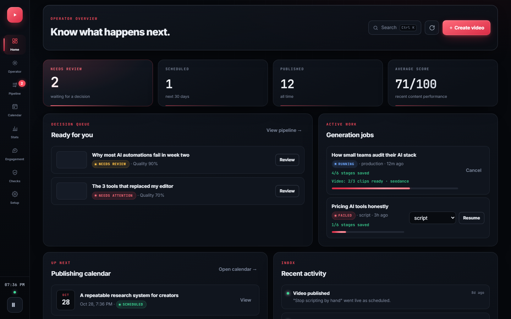
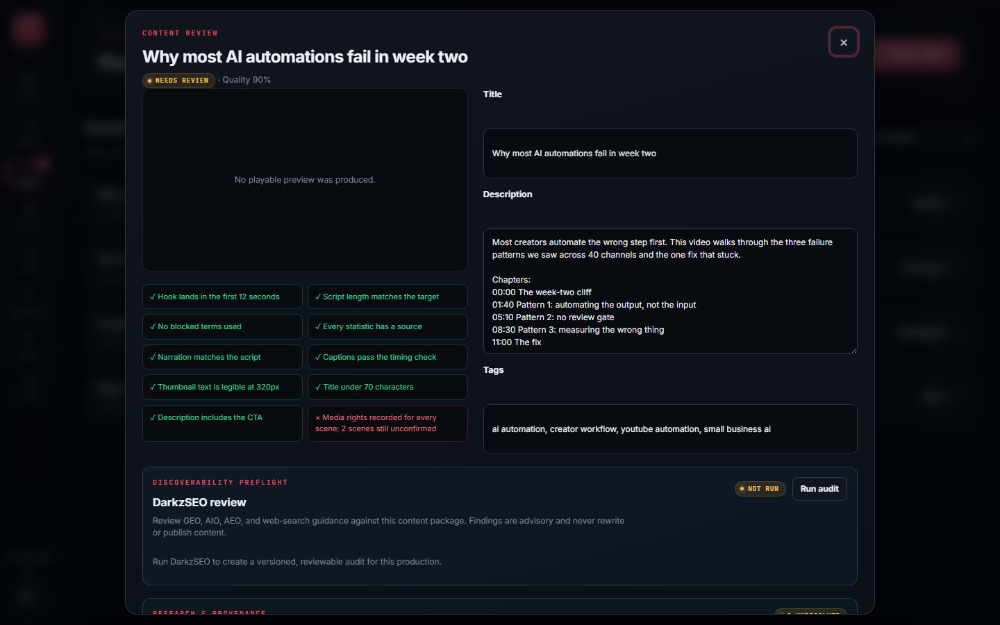
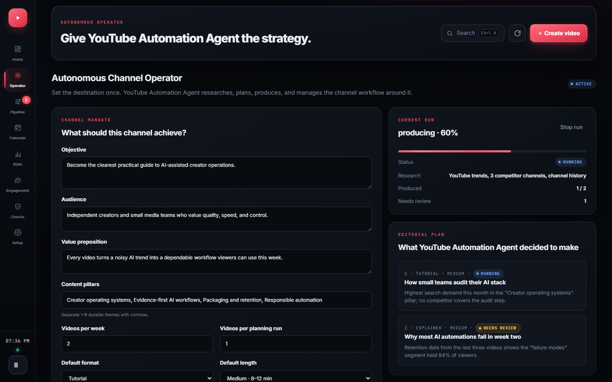

# YouTube Automation Agent

**The open-source AI agent that runs a YouTube channel end to end, with you approving every video before it goes out.**

It researches topics, writes scripts, generates narration and visuals, assembles real MP4s, writes titles, descriptions and tags, schedules approved videos, and learns from analytics and from what your audience says. It runs on your own machine with your own API keys.

[](https://github.com/darkzOGx/youtube-automation-agent/actions/workflows/ci.yml)
[](LICENSE)
[](package.json)
[](https://github.com/darkzOGx/youtube-automation-agent/releases)



|  |  |
| :--: | :--: |
| Content review: quality checks and approval for one video | Autonomous operator: your mandate and the agent's plan |

*Screenshots use sample data so every panel is populated. Regenerate them with `npm run docs:screenshots`.*

## Why it's different

- **You approve before anything is published.** Finished videos wait for fact review, media-rights confirmation, and your approval. Turning on autonomy doesn't skip those checks.
- **Real output only.** Simulated or placeholder media is clearly marked and can never be approved or uploaded.
- **Self-hosted.** Your keys, media, and channel data stay on your machine.
- **Learns from evidence, with your sign-off.** Lessons from analytics, retention curves, and comments shape future videos only after you approve them.
- **Your choice of providers.** Eight text providers or OpenRouter, five AI video providers, or free local slideshow rendering.

## Quick start

You need:

- Node.js 18.17 or newer
- A Google account and YouTube Data API credentials ([setup steps](#youtube-credentials))
- An API key for at least one [text provider](docs/providers.md#text). Gemini has free tiers for text and narration.

```bash
git clone https://github.com/darkzOGx/youtube-automation-agent.git
cd youtube-automation-agent
npm install
npx playwright install chromium   # renders slideshow videos; on Linux add --with-deps
npm run walkthrough
npm start
```

Then open `http://localhost:3456`.

1. **`npm run walkthrough`** explains each provider choice, tests your keys, and connects your YouTube channel. For a shorter flow, use `npm run setup`. Every setting is documented in [`.env.example`](.env.example).
2. **Check readiness.** In the dashboard, open **Production readiness** and choose **Run verified check**. It makes small live text and narration requests, checks access to your channel, and builds and decodes a test MP4, without uploading anything.
3. **Make videos.** Open **Autonomous operator**, describe the channel you want, and choose **Activate & run now**, or create a single video from the dashboard. Finished videos wait in **Pipeline** for your review and approval.

FFmpeg is installed with `npm install` through `ffmpeg-static`.

### YouTube credentials

1. Create a project in [Google Cloud Console](https://console.cloud.google.com/).
2. Enable **YouTube Data API v3**, and **YouTube Analytics API** for retention and outcome data.
3. Create an OAuth 2.0 client of type **Desktop app** (not Web application) and save the JSON as `config/credentials.json`.
4. Under **Google Auth Platform → Audience**, add the Google account that owns your channel as a **test user**. Otherwise sign-in fails with `Error 403: access_denied`. While the app is in Testing mode, Google expires the sign-in after 7 days.

## How it works

| Stage | What the agent does | What you control |
| --- | --- | --- |
| Research | Finds topics and builds a content strategy | Niche, audience, blocked topics |
| Script | Writes the hook, narrative, CTA, and metadata | Voice, format, length, brand direction |
| Production | Generates narration and visuals, then assembles a real MP4 | Provider choice and media fallbacks |
| Review | Runs quality checks and opens the video for review | Facts, media rights, edits, approval |
| Publish | Schedules and uploads approved content | Privacy, timing, final decision |
| Learn | Captures 24-hour and 7-day evidence, measures your chosen outcome, then proposes the next move | Choose the KPI and approve or reject each lesson |

## Features

Each item links to its walkthrough in the [feature guide](docs/features.md).

**Plan**
- [Autonomous Channel Operator](docs/features.md#autonomous-channel-operator): give it an objective, audience, content pillars, cadence, and limits. It researches trends and competitors, builds an evidence-labeled plan, and sends each video through production.
- [Outcome & ROI Studio](docs/features.md#outcome--roi-studio): set a target (views, watch hours, net subscribers, engagement, or revenue) and a budget, and track progress. Missing data shows as unavailable, never as zero.

**Produce**
- [Production readiness](docs/features.md#production-readiness): a verified check of every provider, your channel, and video assembly before anything runs on its own. Paid image and video probes are separate opt-ins.
- [Resumable generation](docs/features.md#resumable-generation): every stage is checkpointed, so a crash or timeout resumes where it stopped instead of starting over.
- [AI video generation](docs/features.md#ai-video-generation): local slideshow by default; Seedance, MiniMax H3, Gemini Omni, Kling, or Wan for real clips, with a cap on paid seconds.
- [Shorts Repurposing Studio](docs/features.md#shorts-repurposing-studio): turn an approved video into three 9:16 Short drafts with burned-in captions, reusing existing media so no new generation credits are spent.

**Review**
- **Content review:** quality checks, metadata editing, approval, and scheduling for each video.
- [Scene Repair Studio](docs/features.md#scene-repair-studio-and-narration): edit, reorder, lock, replace, or regenerate a single scene, then rebuild the video.
- [Evidence desk](docs/features.md#evidence-desk): link each factual claim in the script to a verified source before approval.
- [Discoverability preflight](docs/features.md#discoverability-preflight): advisory search and AI-answer checks from a bundled DarkzSEO audit.

**Learn**
- [Learning loop](docs/features.md#learning-loop): compares each video's 24-hour and 7-day results with your channel's own history and proposes changes for you to approve.
- [Controlled growth experiments](docs/features.md#controlled-growth-experiments): test approved title and thumbnail variants on a live video. A winner needs a 95% evidence threshold, and the original is restored before you decide.
- [Scene-aware retention](docs/features.md#scene-aware-retention): see which scene lost viewers.

**Engage**
- [Audience Engagement Studio](docs/features.md#audience-engagement-studio): comment sync, themes and questions, spam quarantine, reply drafts that post only after you approve them, and video ideas mined from repeated requests.

## AI providers

One key gets you started. Pick a text provider in the walkthrough: Gemini, OpenAI, OpenRouter (400+ models, including Claude), Kimi, MiMo, GLM, DeepSeek, or MiniMax. Gemini has free tiers for text and narration.

- **Narration** comes from ElevenLabs, OpenAI, or Gemini, in that order of preference. A video without working narration can't be approved.
- **Images** come from OpenAI or Gemini, each falling back to the other.
- **Video** is a free local slideshow by default. Choose Seedance, MiniMax H3, Gemini Omni, Kling, or Wan for generated clips and set a cap on paid seconds; if a provider fails, the video falls back to the slideshow.

Models, keys, env vars, clip limits, and the `.env` essentials are in the [providers guide](docs/providers.md).

## Automation

The scheduler starts with `npm start` and uses the server's local time.

| When | What runs |
| --- | --- |
| Daily at 06:00 | Content generation, following the active channel strategy's cadence |
| Every 15 minutes | Publishing queue |
| Daily at 09:00 | Analytics collection |
| Daily at 22:00 | Optimization |
| Every 4 hours | Comment sync and growth-experiment refresh |
| Sundays at 08:00 | Weekly strategy review |

Details are in the [feature guide](docs/features.md#automation-schedule).

## Docs

- [Feature guide](docs/features.md): a walkthrough of every studio and gate.
- [AI providers](docs/providers.md): text, narration, image, and video providers with keys and limits.
- [API reference](docs/api.md): every HTTP route the dashboard server exposes, for example `POST /generate` with `x-api-key`.
- [Troubleshooting](docs/troubleshooting.md): fixes for setup, sign-in, and generation problems.
- [Changelog](CHANGELOG.md) and [releases](https://github.com/darkzOGx/youtube-automation-agent/releases).

The three problems people hit most:

| Problem | Fix |
| --- | --- |
| `Missing credentials for: an AI provider` | Configure any one text provider with `npm run walkthrough`. OpenAI isn't required. |
| Google sign-in shows `Error 403: access_denied` | Add your Google account as a test user under **Google Auth Platform → Audience**. |
| No video is produced, or it's marked simulated | Read the ✗ lines in the startup capability check, and make sure you ran `npx playwright install chromium`. |

Questions and setup help go in [Discussions](https://github.com/darkzOGx/youtube-automation-agent/discussions).

## Contributing

See [CONTRIBUTING.md](CONTRIBUTING.md) for ground rules, project structure, and how to add a provider. Short version: one focused concern per PR, no lockfile churn, lint and tests must pass. Issues are for bugs.

```bash
git clone <your-fork>
cd youtube-automation-agent
npm install
npm run lint   # CI runs this on every PR
npm test
```

Made something real with it? Share verified output in [examples](examples/README.md).

## Built by

[@darkzOGx](https://github.com/darkzOGx), a solo builder shipping AI automation and developer tools. Find me on [X](https://x.com/darkzOGx) and [laderalabs.io](https://laderalabs.io). If YouTube Automation Agent saves you time, a star helps it reach more developers.

## License

MIT. See [LICENSE](LICENSE). Model and API acknowledgments are in the [providers guide](docs/providers.md#acknowledgments).

> This tool is for legitimate content creation. Comply with [YouTube's Terms of Service](https://www.youtube.com/t/terms) and Community Guidelines.

---

More from darkzOGx:

- [darkzloop](https://github.com/darkzOGx/darkzloop): terminal agent runner that turns any LLM into a disciplined software engineer (FSM control, model-agnostic, BYO auth)
- [darkzBOX](https://github.com/darkzOGx/darkzBOX): open-source Instantly.ai clone with smart automated email replies
- [open-sales-researcher](https://github.com/darkzOGx/open-sales-researcher): autonomous B2B company research. Works with Claude Code, Cursor, Copilot.
- [darkzseo](https://github.com/darkzOGx/darkzseo): SEO tooling
- [ConstructionBids.ai](https://constructionbids.ai): AI scans every federal, state & local public works bid and matches you to contracts you'll win.
